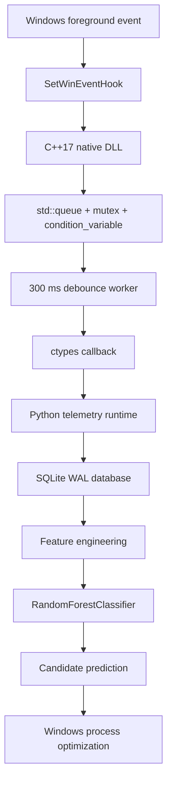
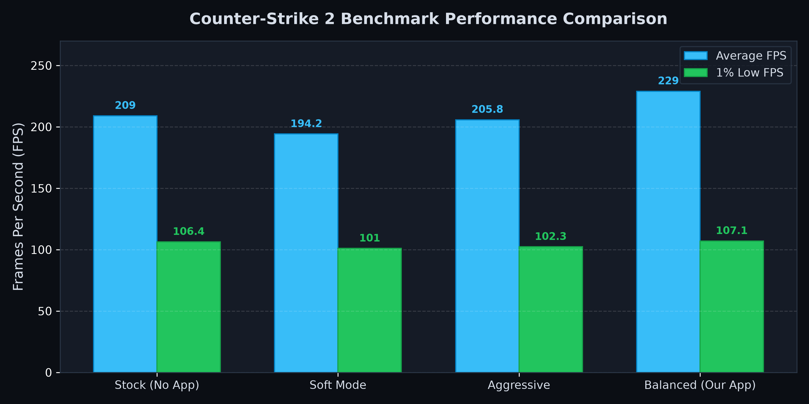
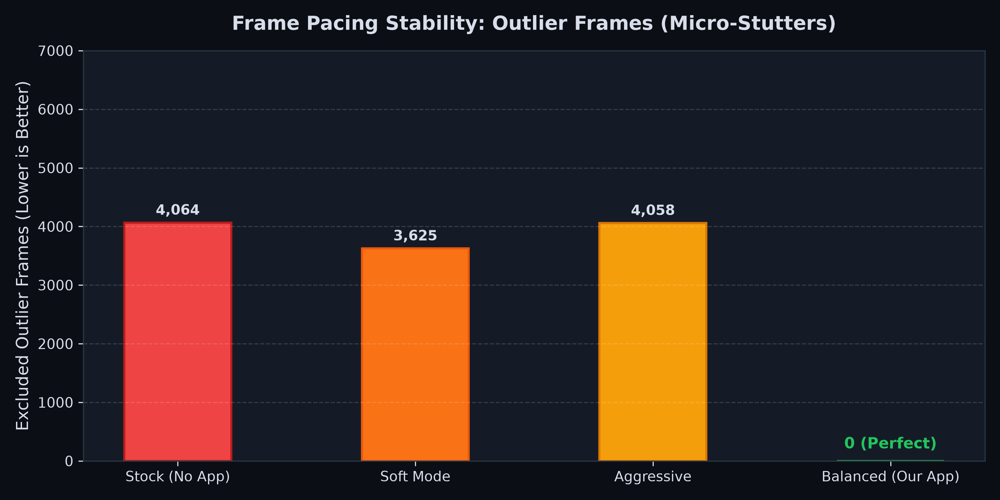

<div align="center">

# ⚡ Adaptive RAM Optimizer

### 🎮 Event-Driven Windows Optimization for Smoother Frame Pacing

<p>
  
  
  
  
  
</p>

<p>
  <strong>A hybrid C++ / Python optimization tool powered by Windows event hooks instead of polling.</strong><br>
  Designed for lower telemetry overhead, fewer unnecessary wake-ups, and more consistent frame pacing.
</p>

<p>
  <a href="#-benchmark-results">📊 Benchmark</a> ·
  <a href="#-setup-and-development">🚀 Setup</a> ·
  <a href="#-technology-and-engineering-stack">🧰 Technologies</a> ·
  <a href="#-security-and-safe-behavior">🛡️ Security</a>
</p>

</div>

---

Windows 10/11 desktop optimization application that monitors foreground window
changes at the OS level, stores telemetry in SQLite, and uses a Random Forest
model to identify background processes that may be suitable optimization
candidates.

> **Note:** This is an experimental Windows optimization tool. Benchmark results
> vary depending on hardware, drivers, Windows settings, and background activity.

## ✨ Key Features

- Event-driven telemetry core using `SetWinEventHook` instead of polling
- `ctypes` callback bridge between a C++17 native DLL and Python
- Producer-consumer queue with 300 ms foreground-event debounce
- Relational telemetry database using SQLite WAL mode
- CPU, RAM, working-set, commit-size, thread, and handle metrics
- Random Forest classification based on observed process behavior
- PyQt6 desktop interface
- One-file Windows `.exe` packaging with PyInstaller
- Automated Windows build artifacts through GitHub Actions

## 🧠 Why Event-Driven?

Traditional system utilities continuously poll and wake the CPU. This project
uses `SetWinEventHook(EVENT_SYSTEM_FOREGROUND)` and runs only when an actual
foreground window change occurs.

| Approach | Behavior |
| --- | --- |
| 🔁 Polling | Periodic timers, unnecessary process scans, and extra scheduler activity |
| ⚡ Event-driven | Native callback and debounce worker triggered by real Windows events |
| 🤖 Adaptive | A model that learns from telemetry and evaluates processes by behavior |

## 🏗️ How It Works



### ⚙️ Native Core

[`optimizer_core.cpp`](optimizer_core.cpp) listens for
`EVENT_SYSTEM_FOREGROUND` through `SetWinEventHook(WINEVENT_OUTOFCONTEXT)`.
The DLL:

1. Receives Windows event callbacks.
2. Pushes events into a thread-safe `std::queue`.
3. Debounces events for 300 ms in a worker thread.
4. Sends the final foreground event to the Python callback.
5. Runs a Windows message pump on the event thread.

This avoids a continuous `while True: sleep(...)` polling loop. Instead of
scanning processes continuously, the application reads the required metrics
after a foreground event.

### 🐍 Python and Data Pipeline

[`optimizer_core.py`](optimizer_core.py) maps the native `TelemetryData` struct
to `ctypes.Structure` and keeps the `WINFUNCTYPE` callback alive.

The telemetry pipeline:

- Stores system snapshots in SQLite.
- Keeps process-level metrics in a separate table.
- Uses SQLite WAL and indexes to reduce read/write contention.
- Derives model features from time, memory, and `focus_ratio` metrics.
- Predicts processes that may be suitable for background optimization.

## 🧰 Technology and Engineering Stack

### 🖥️ Native Windows Layer

- C++17
- Win32 API and `User32`
- `SetWinEventHook`
- `EVENT_SYSTEM_FOREGROUND`
- `WINEVENT_OUTOFCONTEXT`
- Windows message pump
- C-compatible exported DLL API
- `std::thread`, `std::mutex`, `std::condition_variable`, and `std::queue`
- MSVC / Visual Studio 2022 Build Tools
- CMake 3.20+

### 🐍 Python Runtime and Desktop UI

- Python 3.10+
- `ctypes`, `WinDLL`, and `WINFUNCTYPE`
- PyQt6
- `QThread` and Qt signals
- `psutil`
- Python `sqlite3`
- Background worker pattern

### 🤖 Data and Machine Learning

- SQLite WAL (`journal_mode=WAL`)
- Relational telemetry schema
- SQLite indexes and foreign-key relationships
- pandas
- NumPy
- scikit-learn
- `RandomForestClassifier`
- Feature engineering and focus-ratio calculation
- Train/test split
- Classification report, confusion matrix, and accuracy score
- Feature-importance analysis
- joblib model serialization

### 📦 Packaging, Automation, and Visualization

- PyInstaller
- One-file, windowed Windows executable
- GitHub Actions
- Matplotlib
- Automated FPS and frame-pacing charts
- Windows batch build scripts

## 📁 Project Structure

```text
AdaptiveRamOptimizer/
├── app_gui.py                       # Main PyQt6 interface
├── optimizer_core.cpp               # Win32 event hook and C++ worker
├── optimizer_core.h                 # DLL API and TelemetryData struct
├── optimizer_core.py                # ctypes DLL bridge
├── advanced_telemetry_collector.py  # SQLite telemetry collector
├── model_runtime.py                 # Model feature/prediction runtime
├── train_ram_optimizer_model.py     # Manual model-training script
├── training_worker.py               # GUI background-training worker
├── generate_charts.py               # Benchmark chart generator
├── CMakeLists.txt                   # Native DLL build definition
├── requirements.txt                 # Python dependencies
├── AdaptiveRamOptimizer.spec        # PyInstaller specification
├── build_optimizer_core.bat         # C++ DLL build script
├── build_exe.bat                    # Windows EXE build script
├── .github/workflows/
│   └── build-windows.yml            # GitHub Actions Windows build
├── docs/                            # Benchmark images
└── README.md                        # Project documentation
```

## 👤 Running the Application

Download the ready-to-use Windows executable from GitHub Releases and run it.
No installer is required.

User data is stored locally at:

```text
%LOCALAPPDATA%\AdaptiveRamOptimizer
```

Telemetry and trained models are not bundled into the executable. Windows may
deny access to protected or administrator-owned processes; this is expected.
The application does not terminate processes and does not optimize the
foreground process.

## 🚀 Setup and Development

### ✅ Requirements

- Windows 10/11 x64
- Python 3.10 or newer
- Visual Studio 2022 Build Tools
- Desktop C++ workload
- CMake 3.20 or newer

### 📥 Install Python Dependencies

```powershell
py -3 -m pip install -r requirements.txt
```

### 🔧 Build the Native DLL

```powershell
call build_optimizer_core.bat
```

This configures and builds the x64 Release DLL with CMake, then copies it to:

```text
optimizer_core.dll
```

### 🏭 Build the EXE

```powershell
call build_exe.bat
```

Output:

```text
dist\AdaptiveRamOptimizer.exe
```

Command-line alternative:

```powershell
py -3 -m PyInstaller --noconfirm --clean --onefile --windowed `
    --add-binary "optimizer_core.dll;." `
    --name AdaptiveRamOptimizer app_gui.py
```

### ▶️ Run the Application

```powershell
py -3 app_gui.py
```

### 📡 Run the Telemetry Collector

```powershell
py -3 advanced_telemetry_collector.py
```

### 🧪 Train the Model

After collecting enough telemetry:

```powershell
py -3 train_ram_optimizer_model.py
```

Model output:

```text
ram_optimizer_model.pkl
```

## 📊 Benchmark Results

[`generate_charts.py`](generate_charts.py) uses Matplotlib and NumPy to create
FPS comparison and frame-pacing outlier charts:

```powershell
py -3 generate_charts.py
```

The charts used in this README are stored in `docs/`:

### 🎯 Average FPS and 1% Low FPS

<div align="center">
  
</div>

### 🧊 Frame Pacing and Micro-Stutter Outliers

<div align="center">
  
</div>

### 📈 Summary

| Profile | Average FPS | 1% Low FPS | Outlier frames |
| --- | ---: | ---: | ---: |
| Stock (No App) | 209.0 | 106.4 | 4,064 |
| Soft Mode | 194.2 | 101.0 | 3,625 |
| Aggressive | 205.8 | 102.3 | 4,058 |
| **Balanced (Our App)** | **229.0** | **107.1** | **0** |

> 🏆 In this sample run, **Balanced Mode** delivered an approximately **9.57%**
> average FPS increase over the Stock profile. The `0 outlier` result applies
> only to this benchmark run and is not guaranteed on every system.

Benchmark values come from a sample Counter-Strike 2 comparison. They are not
universal performance guarantees.

## ⚙️ GitHub Actions

`.github/workflows/build-windows.yml` produces a Windows artifact when:

- The workflow is manually dispatched.
- A tag matching `v*` is pushed.

The workflow installs dependencies, builds the executable with PyInstaller, and
uploads an artifact named `AdaptiveRamOptimizer-windows`.

## 🛡️ Security and Safe Behavior

- The foreground process is never optimized.
- The application does not terminate processes.
- Windows may block access to protected or elevated processes.
- Low-confidence model predictions are protected.
- User telemetry remains on the local machine.
- User databases, WAL/SHM files, and model files should not be committed to Git.
- `Test (10% RAM)` is experimental and aggressive.
- `Balanced` is recommended for normal use.

## ⚠️ Known Limitations

- Only Windows 10/11 x64 is supported.
- The appropriate Microsoft Visual C++ runtime may be required for the DLL.
- The first run may not have enough data for model training.
- Windows permissions may prevent metrics from being read for some processes.
- Because the model learns from personal usage data, results vary across users
  and systems.
- The manual training script and the GUI training worker may use different model
  hyperparameters.

## 📄 License

MIT License. See [`LICENSE`](LICENSE) for details.
